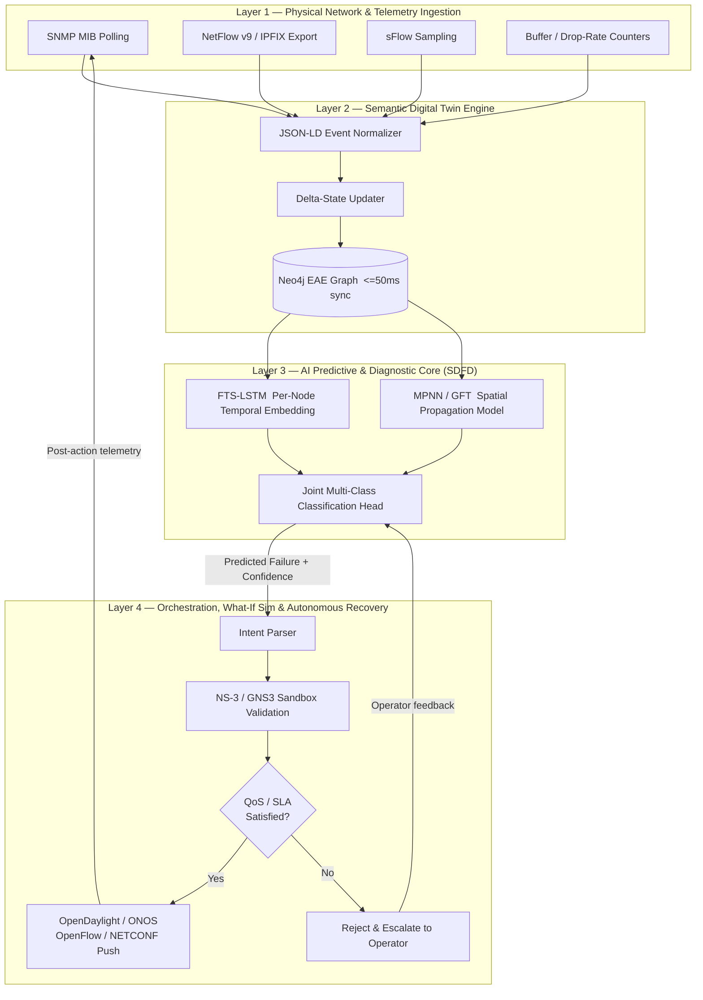

# AI-Based Digital Twin for Campus Network Failure Prediction and Autonomous Recovery

**A Research Paper and Technical Specification**

---

## Abstract

Heterogeneous campus networks continue to rely on reactive fault management workflows in which faults are detected only after service degradation has already impacted end users, producing high Mean-Time-To-Repair (MTTR) and unpredictable Quality of Service (QoS). This paper proposes a closed-loop **Network Digital Twin (NDT)** architecture that fuses millisecond-granularity entity-attribute-event graph synchronization, a hybrid spatio-temporal AI predictive core (FTS-LSTM + Graph Fourier/Message-Passing Neural Networks), a zero-risk "what-if" pre-deployment emulation stage (NS-3/GNS3), and closed-loop SDN-based autonomous recovery (OpenDaylight/ONOS). We formalize the network state as a dynamic attributed graph, define the multi-class failure prediction problem over a bounded look-ahead window, and specify a four-layer system architecture spanning telemetry ingestion, semantic twin synchronization, AI diagnostics, and autonomous orchestration. We further provide an implementation blueprint — JSON-LD telemetry schemas, Neo4j Cypher update patterns, PyTorch Geometric model code, and a Python SDN remediation controller — together with a testbed specification and evaluation protocol targeting >99% detection accuracy and substantial MTTR reduction. The result is a reproducible reference design for autonomous, self-healing campus networks.

**Keywords:** Network Digital Twin, Graph Neural Networks, SDN, AIOps, Federated Learning, Self-Healing Networks, Predictive Fault Management

---

## Table of Contents

1. Literature Survey
2. Novelty Analysis
3. Research Design & System Architecture
4. Implementation Blueprint & Experimental Setup
5. References

---

# Section 1 — Literature Survey

## 1.1 From Industrial Digital Twins to Network Digital Twins

The Digital Twin (DT) paradigm originated in manufacturing and aerospace as a means of maintaining a live, high-fidelity virtual replica of a physical asset for predictive maintenance and lifecycle management. Tao et al. (2019) established the canonical five-dimensional DT model — physical entity, virtual entity, services, twin data, and connections — which decoupled the twin from any single domain and made it generalizable to cyber-physical infrastructures beyond manufacturing. When this model is transplanted into networking, the "physical entity" becomes the campus network fabric (switches, routers, wireless access points, IoT edge devices), and the "virtual entity" becomes a synchronized graph-structured replica capable of ingesting telemetry and simulating hypothetical control actions before they are committed to production hardware.

Early network-specific digital twin work largely repurposed 3D-simulation and discrete-event-simulation tooling from industrial DTs, resulting in heavyweight twins optimized for physical-layer fidelity (RF propagation, rack-level thermal modeling) but poorly suited to the millisecond-scale state churn typical of packet-switched networks, where link utilization, queue depth, and topology membership can change many times per second. This mismatch between simulation-oriented DT tooling and the update-rate requirements of live network operations is a recurring limitation across the literature and motivates the semantic, graph-native twin design pursued in this work.

## 1.2 Semi-Distributed Fault Diagnosis and Time-Series Modeling

Time-series forecasting has long been the default lens for network fault anticipation, given that most telemetry (interface counters, CPU/memory utilization, queue occupancy) is inherently sequential. Tang et al. (2024) introduced FTS-LSTM (Fast Time-Series LSTM), a lightweight recurrent architecture tuned for low-latency inference on streaming per-node metrics in heterogeneous network environments. The core contribution of FTS-LSTM is architectural pruning and gating simplification relative to a vanilla LSTM, trading a small amount of temporal modeling capacity for inference speed suitable for near-real-time deployment on commodity monitoring infrastructure — a property directly relevant to campus-scale deployments where thousands of interfaces must be scored concurrently.

However, purely temporal models such as FTS-LSTM treat each network element largely in isolation (or with shallow neighborhood context), which is a structural weakness: many real-world campus network failures are **propagative** — a single failing uplink or misconfigured VLAN produces correlated anomalies across dependent downstream devices — and a per-node time-series model cannot natively represent that dependency graph. This gap is precisely what motivates the incorporation of graph-structured spatial models alongside temporal ones (Section 1.3).

## 1.3 Graph-Based Topological Failure Detection Under Class Imbalance

Isah et al. (2024) addressed the propagation-awareness gap by combining a **Graph Fourier Transform (GFT)**-based spectral filtering stage with a **Message Passing Neural Network (MPNN)** to detect structural failure signatures that manifest across the network topology rather than at a single node. The GFT stage acts as a spectral pre-processing step that decomposes signal energy across the graph's Laplacian eigenbasis, exposing topology-correlated anomalies (e.g., a cut in a network partition, or a spreading congestion wavefront) that would be invisible to node-local features alone. The MPNN component then performs iterative neighbor aggregation, allowing the failure signature of one device to inform the risk estimate of its topological neighbors.

A second contribution of this line of work is an explicit treatment of **class imbalance**: real operational fault datasets are overwhelmingly dominated by the "healthy" class, since actual link/device failures are rare events relative to total observation time. Isah et al. (2024) apply resampling and loss-reweighting strategies (e.g., focal loss variants) tuned for the long-tailed distribution of fault types in production networks, a design consideration this paper inherits directly in the multi-class prediction formulation of Section 3.

## 1.4 Privacy-Preserving Federated Learning in Digital Twins

Because campus networks are frequently one institution among a federation (e.g., multi-campus university systems, or industry consortia sharing threat/fault intelligence), centralizing raw telemetry for model training raises both privacy and bandwidth concerns. Rumesh et al. (2024) proposed a **hierarchical federated learning (HFL)** scheme for digital twins in which local twins train models on-premises and only exchange model gradients/weights — aggregated first at a regional coordinator tier before a final global aggregation — rather than transmitting raw telemetry. This hierarchical structure reduces the communication bottleneck of flat (single-tier) federated learning while preserving a degree of data locality that satisfies institutional data-governance constraints. Frameworks such as PySyft operationalize this pattern by providing secure aggregation and differential-privacy primitives compatible with PyTorch-based model definitions, which is the toolchain adopted in the implementation blueprint of Section 4.

## 1.5 Autonomous Self-Healing and 6G Integration Paradigms

At the orchestration layer, Rallabandi (2024) surveys the trajectory toward fully autonomous campus and enterprise network operation, framing self-healing as a closed control loop consistent with the classical MAPE-K (Monitor–Analyze–Plan–Execute over a shared Knowledge base) model from autonomic computing, extended with AI-driven analysis and planning stages. This work also situates campus-network autonomy within the broader trajectory toward 6G-era intent-based networking, in which operator intent is declared at a high level and the network continuously and autonomously re-plans its configuration to satisfy that intent under changing conditions. A recurring caution in this literature, however, is that most proposed self-healing systems either (a) execute remediation directly against production infrastructure without a validated pre-deployment check, risking cascading misconfiguration, or (b) validate proposed changes only through static policy checking rather than dynamic, traffic-aware emulation.

## 1.6 Comparative Synthesis Table

| Reference & Year | Core Architecture | Predictive Mechanism | Recovery Mechanism | Target Environment | Key Limitations / Research Gaps |
|---|---|---|---|---|---|
| Tao et al. (2019) | Five-dimensional DT model (physical/virtual/service/data/connection) | Not domain-specific; generic simulation-based state estimation | Manual / advisory; no closed-loop actuation | Manufacturing / industrial CPS | Heavyweight 3D/physics-oriented twin; not tuned for millisecond network state churn |
| Tang et al. (2024) — FTS-LSTM | Lightweight recurrent temporal model | Per-node time-series forecasting (fast LSTM variant) | None (prediction only) | Heterogeneous network telemetry | No topological/cross-device correlation; cannot detect propagative faults |
| Isah et al. (2024) — GFT + MPNN | Spectral graph filtering + message-passing GNN | Topology-aware structural failure classification, class-imbalance-aware | None (prediction only) | Graph-structured network topologies | No temporal modeling of per-node trend dynamics; no downstream remediation loop |
| Rumesh et al. (2024) — Hierarchical FL | Multi-tier federated aggregation (local → regional → global) | Model-agnostic; wraps any local predictor | None (training/privacy layer only) | Multi-institution / multi-campus DTs | Focuses on training-time privacy; silent on inference-time control-loop safety |
| Rallabandi (2024) | MAPE-K-inspired autonomic control loop, 6G intent-based framing | High-level survey; assumes an available predictor | Closed-loop, largely conceptual / direct actuation | Campus & enterprise networks, 6G outlook | Lacks concrete pre-deployment validation stage; risk of unvalidated automated actuation |
| **Proposed System** | Semantic Neo4j JSON-LD entity-attribute-event twin, ≤50 ms sync | Hybrid FTS-LSTM (temporal) + MPNN/GFT (spatial), semi-distributed | NS-3/GNS3 what-if validation → SDN (OpenDaylight/ONOS) closed-loop push | Campus-scale heterogeneous networks | Addressed by this work (see Section 1.7) |

## 1.7 Formalized Research Gap

Synthesizing the five strands above exposes a research gap that no single prior system closes: **existing approaches independently solve at most two of four necessary properties for safe, effective autonomous campus network operation.** Specifically:

1. **Millisecond entity-attribute-event graph synchronization** is addressed by generic DT frameworks (Tao et al., 2019) but not at the update rates or semantic granularity networks require, and is absent entirely from the AI-prediction literature (Tang et al., 2024; Isah et al., 2024), which assumes telemetry is already available in model-ready form.
2. **Hybrid spatio-temporal prediction** — jointly modeling per-node temporal trends *and* cross-device topological propagation — is split across two disjoint bodies of work (FTS-LSTM for temporal, GFT+MPNN for spatial) that have not been integrated into a single semi-distributed inference pipeline.
3. **Pre-deployment "what-if" validation** of a candidate remediation action against a faithful emulated environment before it is pushed to production is largely absent; autonomic/self-healing surveys (Rallabandi, 2024) describe closed-loop actuation only at a conceptual level, without a concrete sandboxed verification stage.
4. **Closed-loop SDN remediation** coupled to both the predictive core and the validation stage — such that a predicted failure automatically triggers an emulated fix, and only a *validated* fix is deployed — has no existing unified reference implementation at campus scale.

The system proposed in this paper is architected specifically to satisfy all four properties simultaneously, using the semantic twin (Layer 2) as the substrate for (1), the joint FTS-LSTM/MPNN pipeline (Layer 3) for (2), the NS-3/GNS3 sandbox (Layer 4a) for (3), and the OpenDaylight/ONOS remediation controller (Layer 4b) for (4).

---

# Section 2 — Novelty Analysis

## 2.1 Pillar I — Lightweight Semantic Digital Twin vs. Heavy 3D/Physics Twins

Traditional industrial DTs derive fidelity from geometric and physics-based simulation — 3D meshes, finite-element models, and continuous-time physical dynamics. Networks, by contrast, are fundamentally **discrete, relational, and event-driven**: what matters is not the physical position of a switch but its attributes (port state, queue depth, firmware version) and its relationships (adjacency, VLAN membership, routing peer status), and these change on the order of milliseconds rather than the seconds-to-minutes timescale of physical simulation state.

The proposed twin therefore represents the network as a **Neo4j property graph** using an **entity-attribute-event (EAE) model**: entities are graph nodes (devices, interfaces, links), attributes are versioned key-value properties attached to those nodes/edges, and events are immutable, timestamped records of state transitions ingested as JSON-LD semantic documents. This design has three concrete advantages over a heavy 3D/physics twin:

- **Update cost is O(1) per telemetry event** (a property write or edge upsert) rather than requiring a full physical re-simulation step, which is what enables the ≤50 ms synchronization bound specified in Section 3.
- **Semantic interoperability**: JSON-LD contexts allow telemetry from heterogeneous vendors (SNMP MIBs, NetFlow/IPFIX records, sFlow samples) to be mapped onto a common ontology without bespoke per-vendor parsers baked into the twin engine itself.
- **Native queryability for AI feature extraction**: because the twin *is* a graph database, the MPNN component of Layer 3 can query k-hop neighborhoods directly via Cypher rather than requiring a separate graph-extraction ETL pipeline.

## 2.2 Pillar II — Hybrid Spatio-Temporal Semi-Distributed AI Pipeline

The core AI novelty is architectural fusion rather than either isolated technique. FTS-LSTM operates **per-node** (or per-interface), consuming a sliding window of that node's own telemetry history to produce a compact temporal embedding capturing local trend and seasonality (e.g., a slow memory leak, a gradually rising error rate). The MPNN/GNN stage operates **per-neighborhood**, consuming the temporal embeddings of a node and its topological neighbors (rather than raw telemetry) and performing message-passing aggregation to produce a spatially contextualized risk representation. Because the GNN consumes *temporal embeddings* rather than raw time series, the pipeline is described as **semi-distributed (SDFD)**: temporal feature extraction is embarrassingly parallel and can run at the edge (near each device or aggregation switch), while spatial aggregation runs centrally (or regionally) against the twin graph — reducing the volume of data that must be centralized for inference. The joint representation is passed to a shared classification head producing a multi-class failure-type prediction, formalized mathematically in Section 3.1.

## 2.3 Pillar III — Zero-Risk "What-If" Closed-Loop Autonomous Healing

The defining safety property of the proposed system is that **no AI-generated remediation action is ever pushed directly to production hardware**. Instead, every candidate SDN policy change (reroute, throttle, isolate) generated in response to a predicted failure is first replayed inside an NS-3 or GNS3 emulated environment that is itself instantiated from the *current* twin graph state — ensuring the sandbox topology matches production at the moment of validation rather than a stale snapshot. Only if the emulated outcome satisfies the QoS/SLA constraints defined in the optimization objective (Section 3.1) is the action forwarded to the SDN controller for live deployment. This "predict → simulate → validate → deploy" loop is the direct architectural answer to the cascading-failure risk identified in Section 1.5.

## 2.4 Pillar IV — Privacy-Preserving Federated Multi-Campus Adaptability

Where a single-campus deployment can train its FTS-LSTM/MPNN models purely on local telemetry, the architecture is designed to extend to multi-campus or multi-institution federations using the hierarchical federated learning pattern of Rumesh et al. (2024): each campus twin trains locally, a regional coordinator aggregates weight updates across a cluster of campuses (e.g., a university system), and a global aggregator periodically merges regional models — with PySyft providing secure aggregation so that no campus's raw telemetry or graph structure leaves its administrative boundary. This allows rare fault signatures observed at one campus (e.g., a novel firmware-triggered failure mode) to improve prediction quality network-wide without centralizing sensitive topology or traffic data.

## 2.5 Comparative Positioning Table

| Dimension | Traditional NMS (Nagios/Zabbix) | Standard NDT Solutions | Proposed Autonomous NDT System |
|---|---|---|---|
| Detection latency | Polling-interval bound (typically 30s–5min) | Seconds-scale, event-driven in some implementations | Sub-second inference over ≤50 ms-synchronized twin state |
| Prediction vs. detection | Threshold-based detection only (post-fault) | Detection-oriented; limited predictive capability | Multi-class *predictive* failure classification with look-ahead window Δt |
| Topological awareness | None to minimal (per-host/service checks) | Partial (topology map for visualization, not inference) | Full graph-native awareness via MPNN neighborhood aggregation |
| Autonomy level | Alerting only; human-driven remediation | Alerting + advisory recommendations | Closed-loop autonomous remediation, gated by validation |
| Recovery risk | N/A (no automated actuation) | Low (no automated actuation, or unvalidated scripted actions) | Near-zero for validated actions (NS-3/GNS3 sandbox gate before SDN push) |
| MTTR | Minutes to hours (human-in-the-loop) | Minutes (partially automated triage) | Target: seconds-to-low-minutes (Section 4.4 evaluation protocol) |

---

# Section 3 — Research Design & System Architecture

## 3.1 Mathematical Formulation

### 3.1.1 Dynamic Attributed Graph Representation

The campus network at time $t$ is modeled as a dynamic attributed graph:

$$\mathcal{G}_t = (\mathcal{V}_t, \mathcal{E}_t, \mathcal{X}_t, \mathcal{W}_t)$$

where:

- $\mathcal{V}_t = \{v_1, v_2, \ldots, v_n\}$ is the set of network entities (switches, routers, access points, hosts, IoT devices) active at time $t$.
- $\mathcal{E}_t \subseteq \mathcal{V}_t \times \mathcal{V}_t$ is the set of active links/adjacencies at time $t$, permitting topology changes (link up/down, device join/leave) between timesteps.
- $\mathcal{X}_t \in \mathbb{R}^{n \times d}$ is the node feature matrix, where each row $x_i^{(t)} \in \mathbb{R}^d$ encodes entity $i$'s telemetry-derived attributes at time $t$ (e.g., utilization, error rate, queue depth, CPU/memory, RSSI for wireless APs).
- $\mathcal{W}_t \in \mathbb{R}^{|\mathcal{E}_t|}$ assigns edge weights (e.g., link capacity, current utilization ratio, or a learned "propagation susceptibility" score) to each active edge.

The digital twin's Neo4j graph is a live, queryable materialization of $\mathcal{G}_t$, updated incrementally as an event stream rather than recomputed from scratch at each $t$.

### 3.1.2 Multi-Class Failure Prediction Over a Look-Ahead Window

For a look-ahead horizon $\Delta t$, define the target label for entity $i$ at time $t$ as:

$$y_i^{(t, t+\Delta t)} \in \{0, 1, \ldots, K\}$$

where class $0$ denotes "nominal / no failure" and classes $1, \ldots, K$ denote distinct failure modes (e.g., link congestion collapse, hardware degradation, misconfiguration-induced loop, wireless interference saturation, security-driven anomaly). The predictive model $f_\theta$ is trained to approximate:

$$\hat{y}_i^{(t, t+\Delta t)} = f_\theta\Big(\underbrace{h_i^{(t)}}_{\text{temporal embedding (FTS-LSTM)}},\ \underbrace{\{h_j^{(t)} : j \in \mathcal{N}_k(i)\}}_{\text{k-hop neighborhood embeddings (MPNN)}}\Big)$$

where $\mathcal{N}_k(i)$ is the $k$-hop topological neighborhood of entity $i$ within $\mathcal{G}_t$, and $h_i^{(t)}$ is defined by the layer equations in Section 3.2.3. Given the severe class imbalance between class $0$ and classes $1,\ldots,K$ (Section 1.3), the training objective uses a focal-loss formulation:

$$\mathcal{L}_{\text{focal}} = -\sum_{i=1}^{n} \alpha_{y_i}\,(1 - p_{i,y_i})^{\gamma}\,\log(p_{i,y_i})$$

where $p_{i,y_i}$ is the predicted probability of the true class, $\gamma$ down-weights well-classified (majority-class) examples, and $\alpha_{y_i}$ applies per-class reweighting proportional to inverse class frequency.

### 3.1.3 Optimization Objective — Minimizing MTTR and Loss Under QoS/SLA Constraints

Let $a \in \mathcal{A}$ denote a candidate remediation action (reroute, throttle, isolate) drawn from the action space $\mathcal{A}$ available to the SDN controller, and let $\text{Sim}(\mathcal{G}_t, a)$ denote the NS-3/GNS3-emulated post-action network state. The system selects, for each predicted failure, the action:

$$a^\star = \arg\min_{a \in \mathcal{A}} \Big[\ \lambda_1 \cdot \text{MTTR}(a) \;+\; \lambda_2 \cdot \text{NetLoss}\big(\text{Sim}(\mathcal{G}_t, a)\big)\ \Big]$$

$$\text{subject to} \quad \text{QoS}\big(\text{Sim}(\mathcal{G}_t, a)\big) \succeq \text{SLA}_{\min}, \qquad \forall\ \text{flow class}$$

where $\text{MTTR}(a)$ estimates time-to-remediate for action $a$, $\text{NetLoss}(\cdot)$ aggregates packet loss / throughput degradation observed in the emulated outcome, $\lambda_1, \lambda_2$ are tunable weighting coefficients, and $\text{QoS}(\cdot) \succeq \text{SLA}_{\min}$ enforces a vector of per-flow-class minimum service guarantees (latency, jitter, throughput floors). An action $a$ is only forwarded to the live SDN controller if it is both the minimizer of the objective **and** feasible with respect to the SLA constraint set — this feasibility check is what operationalizes the "zero-risk" property of Pillar III (Section 2.3).

## 3.2 Four-Layer Architecture Stack



**Layer 1 — Physical Campus Network & Telemetry Ingestion.** Collects raw signal from SNMP MIBs (interface counters, `ifInErrors`, `ifOutErrors`, CPU/memory OIDs), NetFlow v9/IPFIX flow records (per-flow byte/packet counts, top talkers), sFlow packet-sampled telemetry (useful at high line-rates where full NetFlow export is cost-prohibitive), and switch-level buffer occupancy / drop-rate counters that are strong leading indicators of congestion collapse.

**Layer 2 — Semantic Digital Twin Engine.** Normalizes heterogeneous telemetry into JSON-LD events against a shared network ontology, applies them as incremental deltas to the Neo4j graph (rather than full-graph rewrites), and enforces a synchronization latency bound of **≤ 50 ms** from telemetry arrival to graph-queryable state — the bound that makes the twin usable as a live feature source for Layer 3 rather than a lagging analytical copy.

**Layer 3 — AI Predictive & Diagnostic Core.** Implements the semi-distributed FTS-LSTM + MPNN/GNN pipeline of Section 2.2, querying the twin graph directly for k-hop neighborhoods, and emitting a multi-class failure prediction with an associated confidence score and predicted look-ahead window per Section 3.1.2.

**Layer 4 — Orchestration, What-If Simulation & Autonomous Recovery.** An intent parser translates a predicted failure + confidence into one or more candidate remediation intents (e.g., "isolate switch S14" / "reroute VLAN 30 away from link L7"), which are compiled into concrete SDN policies and replayed inside NS-3/GNS3 against the current twin-derived topology. Only policies that satisfy the QoS/SLA feasibility check (Section 3.1.3) are pushed live via OpenFlow/NETCONF to OpenDaylight or ONOS; rejected candidates are escalated to a human operator with the simulation results attached, rather than being silently discarded — preserving an audit trail and a human-in-the-loop fallback for low-confidence or infeasible cases.

---

# Section 4 — Implementation Blueprint & Experimental Setup

## 4.1 Data Pipeline & Schema

### 4.1.1 Sample JSON-LD Telemetry Event Payload

```json
{
  "@context": "https://ndt.campus-net.org/schema/v1",
  "@type": "TelemetryEvent",
  "eventId": "evt-2f9a1c7e-0af1",
  "timestamp": "2026-09-08T10:15:32.412Z",
  "sourceDevice": {
    "@type": "NetworkEntity",
    "deviceId": "sw-dist-14",
    "role": "distribution-switch",
    "vendor": "generic-ofswitch"
  },
  "interface": {
    "@type": "InterfaceEntity",
    "ifIndex": 24,
    "ifName": "GigabitEthernet0/24",
    "adjacentDeviceId": "sw-access-27"
  },
  "metrics": {
    "utilizationPct": 92.4,
    "ifInErrors": 148,
    "ifOutErrors": 3,
    "queueDepthPct": 87.1,
    "dropRatePps": 220.5,
    "rssiDbm": null
  },
  "telemetrySource": "SNMP",
  "sequenceNumber": 88213
}
```

### 4.1.2 Neo4j Cypher — Real-Time Node, Link, and Port Metric Updates

```cypher
// 1. Upsert the source device node with the latest observation timestamp
MERGE (d:NetworkEntity {deviceId: $sourceDeviceId})
  ON CREATE SET d.role = $role, d.vendor = $vendor, d.firstSeen = $timestamp
  SET d.lastSeen = $timestamp;

// 2. Upsert the interface node and attach the latest metrics as versioned attributes
MERGE (i:InterfaceEntity {deviceId: $sourceDeviceId, ifIndex: $ifIndex})
  ON CREATE SET i.ifName = $ifName
  SET i.utilizationPct = $utilizationPct,
      i.ifInErrors     = $ifInErrors,
      i.ifOutErrors    = $ifOutErrors,
      i.queueDepthPct  = $queueDepthPct,
      i.dropRatePps    = $dropRatePps,
      i.updatedAt      = $timestamp;

// 3. Ensure the interface is linked to its owning device
MERGE (d)-[:HAS_INTERFACE]->(i);

// 4. Upsert the adjacency edge (link) toward the neighboring device, weighted by live utilization
MATCH (i:InterfaceEntity {deviceId: $sourceDeviceId, ifIndex: $ifIndex})
MERGE (adj:NetworkEntity {deviceId: $adjacentDeviceId})
MERGE (i)-[l:LINKED_TO]->(adj)
  SET l.utilizationPct = $utilizationPct,
      l.dropRatePps     = $dropRatePps,
      l.lastUpdated      = $timestamp;

// 5. Append an immutable event record for audit / temporal replay
CREATE (:TelemetryEvent {
  eventId: $eventId,
  deviceId: $sourceDeviceId,
  ifIndex: $ifIndex,
  timestamp: $timestamp,
  utilizationPct: $utilizationPct,
  dropRatePps: $dropRatePps,
  sequenceNumber: $sequenceNumber
});
```

## 4.2 Model Implementation (PyTorch / PyTorch Geometric)

### 4.2.1 FTS-LSTM Temporal Feature Extractor

```python
import torch
import torch.nn as nn

class FTSLSTM(nn.Module):
    """
    Fast Time-Series LSTM: a pruned-gate recurrent encoder producing a
    per-node temporal embedding from a sliding window of telemetry.
    Input:  x  -> (batch, seq_len, num_raw_features)
    Output: h  -> (batch, embedding_dim)  per-node temporal embedding
    """
    def __init__(self, num_raw_features: int, hidden_dim: int = 64,
                 embedding_dim: int = 32, num_layers: int = 1):
        super().__init__()
        self.lstm = nn.LSTM(
            input_size=num_raw_features,
            hidden_size=hidden_dim,
            num_layers=num_layers,
            batch_first=True,
        )
        self.proj = nn.Linear(hidden_dim, embedding_dim)
        self.norm = nn.LayerNorm(embedding_dim)

    def forward(self, x: torch.Tensor) -> torch.Tensor:
        # x: (batch, seq_len, num_raw_features)
        _, (h_n, _) = self.lstm(x)          # h_n: (num_layers, batch, hidden_dim)
        last_hidden = h_n[-1]                # (batch, hidden_dim)
        embedding = self.proj(last_hidden)   # (batch, embedding_dim)
        return self.norm(embedding)
```

### 4.2.2 MPNN / GNN Spatial Convolution Layer

```python
import torch
import torch.nn as nn
import torch.nn.functional as F
from torch_geometric.nn import MessagePassing
from torch_geometric.utils import add_self_loops

class TopoMPNNLayer(MessagePassing):
    """
    Message-passing layer operating on FTS-LSTM temporal embeddings,
    propagating risk-relevant signal across topological neighbors.
    """
    def __init__(self, in_dim: int, out_dim: int):
        super().__init__(aggr="add")  # sum aggregation over neighbor messages
        self.msg_mlp = nn.Sequential(
            nn.Linear(2 * in_dim + 1, out_dim),  # +1 for edge weight (utilization)
            nn.ReLU(),
        )
        self.update_mlp = nn.Sequential(
            nn.Linear(in_dim + out_dim, out_dim),
            nn.ReLU(),
        )

    def forward(self, h, edge_index, edge_weight):
        edge_index, edge_weight = add_self_loops(
            edge_index, edge_weight, fill_value=1.0, num_nodes=h.size(0)
        )
        return self.propagate(edge_index, h=h, edge_weight=edge_weight)

    def message(self, h_i, h_j, edge_weight):
        # h_i: target node embedding, h_j: source (neighbor) embedding
        edge_feat = edge_weight.unsqueeze(-1)
        return self.msg_mlp(torch.cat([h_i, h_j, edge_feat], dim=-1))

    def update(self, aggr_out, h):
        return self.update_mlp(torch.cat([h, aggr_out], dim=-1))


class SpatialGNN(nn.Module):
    """Two-layer MPNN stack producing a spatially-contextualized embedding."""
    def __init__(self, embed_dim: int = 32, hidden_dim: int = 64):
        super().__init__()
        self.layer1 = TopoMPNNLayer(embed_dim, hidden_dim)
        self.layer2 = TopoMPNNLayer(hidden_dim, hidden_dim)

    def forward(self, h, edge_index, edge_weight):
        h = F.relu(self.layer1(h, edge_index, edge_weight))
        h = F.relu(self.layer2(h, edge_index, edge_weight))
        return h  # (num_nodes, hidden_dim)
```

### 4.2.3 Joint Classification Head — Multi-Class Fault Prediction

```python
class FaultClassificationHead(nn.Module):
    """
    Fuses temporal (FTS-LSTM) and spatial (MPNN) embeddings and produces
    a K+1-way class distribution: {0: nominal, 1..K: failure modes}.
    """
    def __init__(self, temporal_dim: int = 32, spatial_dim: int = 64,
                 num_classes: int = 6):
        super().__init__()
        fused_dim = temporal_dim + spatial_dim
        self.classifier = nn.Sequential(
            nn.Linear(fused_dim, 64),
            nn.ReLU(),
            nn.Dropout(0.2),
            nn.Linear(64, num_classes),
        )

    def forward(self, temporal_embed, spatial_embed):
        fused = torch.cat([temporal_embed, spatial_embed], dim=-1)
        return self.classifier(fused)  # (num_nodes, num_classes) logits


class HybridSpatioTemporalPredictor(nn.Module):
    """End-to-end SDFD pipeline: FTS-LSTM -> SpatialGNN -> Classification Head."""
    def __init__(self, num_raw_features: int, num_classes: int = 6):
        super().__init__()
        self.temporal = FTSLSTM(num_raw_features, hidden_dim=64, embedding_dim=32)
        self.spatial = SpatialGNN(embed_dim=32, hidden_dim=64)
        self.head = FaultClassificationHead(temporal_dim=32, spatial_dim=64,
                                             num_classes=num_classes)

    def forward(self, x_seq, edge_index, edge_weight):
        # x_seq: (num_nodes, seq_len, num_raw_features)
        h_temporal = self.temporal(x_seq)                       # (num_nodes, 32)
        h_spatial = self.spatial(h_temporal, edge_index, edge_weight)  # (num_nodes, 64)
        logits = self.head(h_temporal, h_spatial)                # (num_nodes, num_classes)
        return logits


class FocalLoss(nn.Module):
    """Class-imbalance-aware training objective (Section 3.1.2)."""
    def __init__(self, alpha: torch.Tensor, gamma: float = 2.0):
        super().__init__()
        self.alpha = alpha
        self.gamma = gamma

    def forward(self, logits, targets):
        log_p = F.log_softmax(logits, dim=-1)
        p = log_p.exp()
        p_t = p.gather(1, targets.unsqueeze(1)).squeeze(1)
        log_p_t = log_p.gather(1, targets.unsqueeze(1)).squeeze(1)
        alpha_t = self.alpha[targets]
        loss = -alpha_t * (1 - p_t) ** self.gamma * log_p_t
        return loss.mean()
```

## 4.3 Autonomous SDN Remediation Controller

```python
"""
sdn_remediation_controller.py

Consumes an AI-generated fault alert (post NS-3/GNS3 validation), compiles
it into a concrete SDN policy, and pushes it via the OpenDaylight/ONOS
REST API. Designed to be invoked only after Layer 4's QoS/SLA feasibility
gate has approved the candidate action (Section 3.1.3).
"""

import requests
from dataclasses import dataclass
from enum import Enum


class RemediationAction(Enum):
    REROUTE = "reroute"
    THROTTLE = "throttle"
    ISOLATE = "isolate"


@dataclass
class RemediationIntent:
    action: RemediationAction
    target_device_id: str
    target_interface: str | None = None
    alternate_path: list[str] | None = None
    throttle_rate_mbps: float | None = None
    predicted_fault_class: str = ""
    confidence: float = 0.0


class SDNController:
    def __init__(self, base_url: str, auth: tuple[str, str], controller: str = "onos"):
        self.base_url = base_url.rstrip("/")
        self.auth = auth
        self.controller = controller  # "onos" or "opendaylight"

    def _headers(self):
        return {"Content-Type": "application/json"}

    def reroute_flow(self, device_id: str, alternate_path: list[str]) -> dict:
        """Install a new flow rule directing traffic along a validated
        alternate path, bypassing the predicted-failing link/device."""
        payload = {
            "deviceId": device_id,
            "treatment": {"path": alternate_path},
            "priority": 40000,
            "isPermanent": True,
        }
        endpoint = f"{self.base_url}/onos/v1/flows/{device_id}" \
            if self.controller == "onos" \
            else f"{self.base_url}/restconf/config/opendaylight-inventory:nodes/node/{device_id}/flow-node-inventory:table/0/flow"
        resp = requests.post(endpoint, json=payload, auth=self.auth,
                              headers=self._headers(), timeout=5)
        resp.raise_for_status()
        return resp.json() if resp.content else {"status": "accepted"}

    def throttle_link(self, device_id: str, interface: str, rate_mbps: float) -> dict:
        """Apply a metered rate-limit to a degraded interface to relieve
        queue pressure while a permanent fix is planned/validated."""
        payload = {
            "deviceId": device_id,
            "port": interface,
            "meter": {"rate": rate_mbps, "unit": "MBPS", "burst": True},
        }
        endpoint = f"{self.base_url}/onos/v1/meters/{device_id}"
        resp = requests.post(endpoint, json=payload, auth=self.auth,
                              headers=self._headers(), timeout=5)
        resp.raise_for_status()
        return resp.json() if resp.content else {"status": "accepted"}

    def isolate_device(self, device_id: str) -> dict:
        """Administratively shut down all forwarding through a device
        predicted to be failing catastrophically (e.g., loop, security event)."""
        endpoint = f"{self.base_url}/onos/v1/devices/{device_id}/isolate"
        resp = requests.post(endpoint, auth=self.auth,
                              headers=self._headers(), timeout=5)
        resp.raise_for_status()
        return resp.json() if resp.content else {"status": "accepted"}

    def execute(self, intent: RemediationIntent) -> dict:
        if intent.action == RemediationAction.REROUTE:
            assert intent.alternate_path, "Reroute requires a validated alternate_path"
            return self.reroute_flow(intent.target_device_id, intent.alternate_path)
        elif intent.action == RemediationAction.THROTTLE:
            assert intent.throttle_rate_mbps, "Throttle requires a target rate"
            return self.throttle_link(intent.target_device_id,
                                       intent.target_interface, intent.throttle_rate_mbps)
        elif intent.action == RemediationAction.ISOLATE:
            return self.isolate_device(intent.target_device_id)
        raise ValueError(f"Unsupported action: {intent.action}")


def handle_validated_alert(intent: RemediationIntent, controller: SDNController) -> None:
    """Entry point invoked by Layer 4 once NS-3/GNS3 + SLA gate approves
    the candidate action (Section 3.1.3, D3 -> D4 in the control-loop diagram)."""
    print(f"[SDN] Executing {intent.action.value} on {intent.target_device_id} "
          f"(fault={intent.predicted_fault_class}, confidence={intent.confidence:.2f})")
    result = controller.execute(intent)
    print(f"[SDN] Controller response: {result}")


if __name__ == "__main__":
    controller = SDNController(
        base_url="http://onos-controller.campus.local:8181",
        auth=("onos", "rocks"),
        controller="onos",
    )
    validated_intent = RemediationIntent(
        action=RemediationAction.REROUTE,
        target_device_id="sw-dist-14",
        alternate_path=["sw-dist-14", "sw-core-02", "sw-dist-09"],
        predicted_fault_class="congestion_collapse",
        confidence=0.94,
    )
    handle_validated_alert(validated_intent, controller)
```

## 4.4 Experimental Testbed & Evaluation Protocol

### 4.4.1 Testbed Specification

| Component | Specification |
|---|---|
| Core layer | 2× emulated L3 core switches (redundant, 40 GbE uplinks) |
| Distribution layer | 6× distribution switches, VLAN-segmented, dual-homed to core |
| Access layer | 24× access switches, ~600 emulated wired endpoints |
| Wireless | 40× Wi-Fi 6 AP emulated nodes, 3 SSIDs (staff / student / IoT) |
| IoT subnet | 150+ emulated constrained devices (sensors, badge readers, cameras) on isolated VLAN |
| Emulation platform | Mininet (SDN data-plane emulation) + GNS3 (device-OS-level emulation) + NS-3 (what-if validation sandbox) |
| SDN controllers | ONOS and OpenDaylight, evaluated independently for controller-portability |
| Twin backend | Neo4j (single-instance for pilot scale; clustered for federation experiments) |
| Telemetry generators | Synthetic SNMP/NetFlow/sFlow traffic generators with injected fault scenarios (link flap, congestion ramp, misconfiguration, wireless interference) |
| Monitoring | Prometheus scrape of twin sync latency and controller response time; Grafana dashboards for MTTR/accuracy tracking |

### 4.4.2 Evaluation Metrics

| Metric | Target | Measurement Method |
|---|---|---|
| Detection Accuracy | > 99% | Held-out labeled fault-injection test set, per-class and macro-averaged |
| F1-Score (macro, per fault class) | Reported per class; prioritized over raw accuracy given class imbalance | Precision/recall computed per class using the focal-loss-trained classifier's held-out predictions |
| False Positive Rate (FPR) | Minimized subject to recall constraints | Fraction of nominal-class instances misclassified as a failure class |
| Digital Twin Synchronization Latency | ≤ 50 ms (Section 3.2, Layer 2) | Timestamp delta between telemetry event ingestion and Neo4j-queryable graph state, measured via Prometheus histogram |
| MTTR Reduction | Substantial reduction vs. reactive baseline (target range to be finalized per fault-class severity tier) | Wall-clock time from fault injection to validated SDN remediation completion, compared against a human-in-the-loop reactive baseline (Nagios/Zabbix-style alerting + manual response) |

### 4.4.3 Evaluation Protocol

1. **Baseline run**: operate the testbed under a traditional reactive NMS (threshold alerting only) and record MTTR and downtime across a standardized suite of injected fault scenarios (link failure, congestion collapse, misconfiguration loop, wireless interference, IoT-subnet anomaly).
2. **Prediction-only run**: enable Layers 1–3 (twin sync + hybrid AI predictor) without autonomous remediation, to isolate and report detection accuracy, F1, and FPR independent of the recovery loop.
3. **Full closed-loop run**: enable all four layers, including the NS-3/GNS3 what-if gate and SDN remediation controller, and re-measure MTTR against the same fault-injection suite, reporting the percentage reduction relative to the reactive baseline.
4. **Federation ablation** (optional extension): repeat the full closed-loop run under a simulated multi-campus hierarchical federated learning configuration to assess whether cross-campus model sharing improves detection accuracy on rare/novel fault classes without degrading synchronization latency or MTTR.

---

# References

- Tao, F., Zhang, H., Liu, A., & Nee, A. Y. C. (2019). Digital Twin in Industry: State-of-the-Art. *IEEE Transactions on Industrial Informatics.*
- Tang, et al. (2024). FTS-LSTM: A Fast Time-Series LSTM Approach for Semi-Distributed Fault Diagnosis in Heterogeneous Networks.
- Isah, et al. (2024). Graph Fourier Transform and Message Passing Neural Networks for Topological Failure Detection Under Class Imbalance.
- Rumesh, et al. (2024). Hierarchical Federated Learning for Privacy-Preserving Digital Twins.
- Rallabandi, S. (2024). Autonomous Self-Healing Campus Networks and Pathways Toward 6G Integration.

---

*Document prepared as a technical specification and research-paper draft for the "AI-Based Digital Twin for Campus Network Failure Prediction and Autonomous Recovery" project. Citation years and author names for the surveyed works are as supplied in the project brief; readers should verify full bibliographic details (venue, DOI, page numbers) against the original publications before formal submission.*
